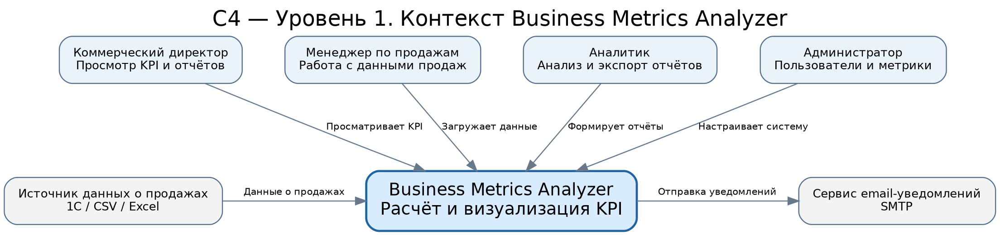
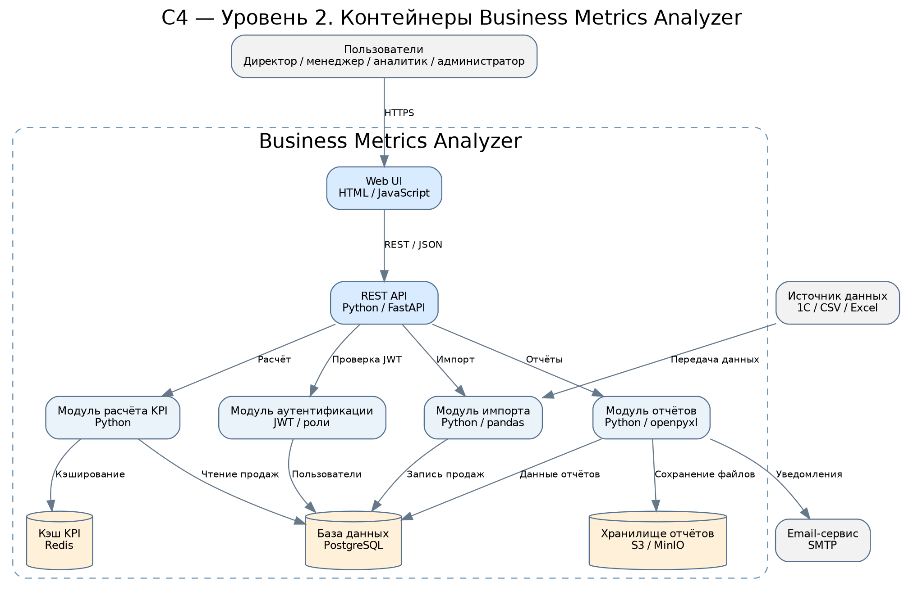

# Архитектура Business Metrics Analyzer

## 1. Архитектурные драйверы

Архитектурные драйверы определяют ключевые функциональные, нефункциональные и бизнес-требования, влияющие на проектирование системы Business Metrics Analyzer.

| ID | Драйвер | Тип | Приоритет | Влияние на архитектуру |
|---|---|---|---|---|
| AD-01 | Время отклика дашборда не более 3 секунд | Нефункциональный | Высокий | Кэширование в Redis и предварительный расчёт KPI |
| AD-02 | Разграничение доступа по ролям | Нефункциональный | Высокий | Аутентификация JWT и ролевая авторизация |
| AD-03 | Импорт до 1 млн записей о продажах | Нефункциональный | Высокий | Пакетная и асинхронная обработка данных |
| AD-04 | Быстрая разработка MVP | Бизнес | Высокий | Использование слоистого монолита |
| AD-05 | Импорт данных из CSV, Excel и API | Функциональный | Высокий | Выделение модуля импорта данных |
| AD-06 | Формирование и экспорт отчётов Excel и PDF | Функциональный | Средний | Выделение модуля формирования отчётов |
| AD-07 | Развёртывание приложения в облаке | Нефункциональный | Высокий | Использование контейнеризации Docker |

## 2. Выбор архитектурного стиля

Для разработки веб-приложения Business Metrics Analyzer выбран слоистый монолит с элементами Clean Architecture.

Архитектура предусматривает логическое разделение приложения на четыре слоя:

1. Presentation — пользовательский интерфейс и обработка HTTP-запросов.
2. Application — бизнес-сценарии импорта данных, расчёта KPI, управления пользователями и формирования отчётов.
3. Domain — бизнес-модели, правила расчёта KPI и валидация данных.
4. Infrastructure — взаимодействие с PostgreSQL, Redis, файловым хранилищем и внешними системами.

### Обоснование выбора

Слоистый монолит выбран по следующим причинам:

- Небольшая команда разработчиков и необходимость быстрого создания MVP.
- Простота разработки, тестирования и развёртывания единого приложения.
- Разделение ответственности между слоями и модулями системы.
- Возможность изолировать бизнес-логику от инфраструктурных зависимостей.
- Поддержка кэширования и предварительного расчёта KPI для обеспечения требуемого времени отклика.
- Возможность последующего выделения отдельных модулей в микросервисы при увеличении нагрузки.

### Ограничения выбранного подхода

Монолитное приложение имеет общую единицу развёртывания, поэтому отдельные функциональные модули нельзя независимо масштабировать и выпускать без дополнительного выделения в самостоятельные сервисы. Для учебного MVP данные ограничения являются приемлемыми.

## 3. Вывод

Выбранная архитектура соответствует основным требованиям Business Metrics Analyzer: обработке данных о продажах, расчёту KPI, формированию отчётов, разграничению доступа и облачному развёртыванию. Слоистая организация приложения обеспечивает сопровождаемость и возможность дальнейшего развития системы.
## 4. Диаграмма контекста C4 (уровень 1)

**Рисунок 1 — Контекстная диаграмма C4 системы Business Metrics Analyzer**

Диаграмма контекста C4 первого уровня показывает взаимодействие системы Business Metrics Analyzer с пользователями и внешними системами.

Основными пользователями приложения являются коммерческий директор, менеджер по продажам, аналитик и администратор. Коммерческий директор просматривает KPI и отчёты, менеджер работает с данными о продажах, аналитик анализирует показатели и формирует отчёты, а администратор управляет пользователями и настройками системы.

Внешними системами являются источник данных о продажах (1С, CSV, Excel) и сервис email-уведомлений. Источник предоставляет данные для анализа, а сервис уведомлений используется для отправки сообщений пользователям.

## 5. Диаграмма контейнеров C4 (уровень 2)

**Рисунок 2 — Диаграмма контейнеров C4 системы Business Metrics Analyzer**

Диаграмма контейнеров C4 второго уровня раскрывает внутреннюю архитектуру приложения Business Metrics Analyzer и взаимодействие его основных элементов.

Пользователи взаимодействуют с системой через Web UI. Запросы обрабатываются REST API, реализованным на Python с использованием FastAPI.

В составе единого серверного приложения выделены логические модули аутентификации, импорта данных, расчёта KPI и формирования отчётов. Модуль аутентификации обеспечивает проверку JWT и разграничение доступа. Модуль импорта отвечает за получение и обработку данных о продажах. Модуль KPI рассчитывает показатели эффективности, а модуль отчётов формирует документы для экспорта.

PostgreSQL используется для хранения данных о продажах, пользователях и показателях. Redis предназначен для кэширования KPI, а файловое хранилище S3/MinIO — для сохранения сформированных отчётов.

Все функциональные модули серверной части входят в состав слоистого монолита с элементами Clean Architecture. Такое разделение упрощает сопровождение приложения и позволяет развивать его функциональность.
